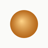

 

 

## Selected work

<table>
  <tr>
    <td width="64" align="center"></td>
    <td><b>Lunar</b> · school assistant for Portuguese secondary students. Today's classes, the timetable read from a photo, a study plan for every test and an assistant that asks before it acts. Built solo for iPhone, web and Android on one Supabase backend. <code>SwiftUI · WidgetKit · Kotlin · Supabase</code></td>
    <td width="150"><a href="https://soldergg.github.io/lunar">Case study</a> <a href="https://lunar-escola.vercel.app">Live site</a></td>
  </tr>
  <tr>
    <td align="center"></td>
    <td><b>SolarCalc</b> · what solar panels would save a Portuguese home. PVGIS irradiance, real tariffs, a roof drawn on a satellite map and a 3D house that explains every step. <code>Three.js · Leaflet · PVGIS</code></td>
    <td><a href="https://soldergg.github.io/solarcalc">Case study</a> <a href="https://solarcalc-livid.vercel.app">Live site</a></td>
  </tr>
  <tr>
    <td align="center"></td>
    <td><b>TeeUp</b> · golf companion for Portugal. Hole-by-hole scorecards, the World Handicap System, nearby courses and rounds with friends, offline first. <code>SwiftUI · MapKit · WeatherKit · Supabase</code></td>
    <td><a href="https://soldergg.github.io/teeup">Case study</a> <a href="https://github.com/SoldergG/TeeUp">Code</a></td>
  </tr>
  <tr>
    <td align="center"></td>
    <td><b>Podcast Helper</b> · remote podcast studio. Every guest records locally in full quality on a shared clock, and files travel peer to peer. <code>Next.js · WebRTC · AudioWorklet · Capacitor</code></td>
    <td><a href="https://soldergg.github.io/podcast-helper">Case study</a> <a href="https://podcasthelper.vercel.app">Live site</a> · <a href="https://github.com/SoldergG/podcasthelper">Code</a></td>
  </tr>
  <tr>
    <td align="center"></td>
    <td><b>KebabLocator</b> · the best kebab near you, on a native map. Live on the App Store, with an Android version in Compose. <code>SwiftUI · MapKit · Kotlin · PostGIS</code></td>
    <td><a href="https://apps.apple.com/us/app/kebablocator/id6761265002">App Store</a> <a href="https://github.com/SoldergG/KebabLocator-iOS">Code</a></td>
  </tr>
</table>

 

## Activity

  

 

<b>All projects</b>

### iOS and macOS

| Project | Description | Stack |
|---------|-------------|-------|
| [TeeUp](https://github.com/SoldergG/TeeUp) | Golf companion for Portugal: rounds, courses, handicap, live stats | SwiftUI · Supabase |
| [Flo](https://github.com/SoldergG/Flo) | Mindful productivity: tasks, habits, focus timer, AI assistant, journaling | SwiftUI · macOS |
| [KebabLocator-iOS](https://github.com/SoldergG/KebabLocator-iOS) | Find the best kebab spots near you, on the App Store | SwiftUI · Supabase |
| [ai-chat-swift](https://github.com/SoldergG/ai-chat-swift) | Native iOS chat with the Claude API, streaming and history | SwiftUI · Anthropic |
| [swift-ui-components](https://github.com/SoldergG/swift-ui-components) | SolderUIKit: toasts, skeleton loaders, ratings, glass cards | SwiftUI · SPM |
| [swiftui-gallery](https://github.com/SoldergG/swiftui-gallery) | 35+ copy-paste SwiftUI components, like shadcn/ui for SwiftUI | SwiftUI · Next.js |

### Android

| Project | Description | Stack |
|---------|-------------|-------|
| [KebabLocator-Android](https://github.com/SoldergG/KebabLocator-Android) | Native Android kebab finder with interactive maps | Kotlin · Compose · Supabase |

### Web

| Project | Description | Stack |
|---------|-------------|-------|
| [SoldergG.github.io](https://github.com/SoldergG/SoldergG.github.io) | This portfolio: case studies with scroll stories, PT/EN | HTML · GSAP · Lenis |
| [podcasthelper](https://github.com/SoldergG/podcasthelper) | Remote podcast studio with synced local recording and P2P file sharing | Next.js 16 · WebRTC · Capacitor |
| [espalha-ideias](https://github.com/SoldergG/espalha-ideias) | Rebuild of espalhaideias.pt for a real client, with an admin CMS | Next.js 16 · Supabase |
| [desporto-mais](https://github.com/SoldergG/desporto-mais) | Rebuild of desportomais.pt, sister brand of Espalha Ideias | Next.js · Supabase |
| [SolarCalc](https://solarcalc-livid.vercel.app) | Solar calculator for Portuguese homes: roof on satellite imagery, PVGIS, payback | Three.js · Leaflet · PVGIS |
| [expense-tracker](https://github.com/SoldergG/expense-tracker) | Personal finance dashboard with charts and categories | Next.js 15 · Recharts · Supabase |
| [schema-visualizer](https://github.com/SoldergG/schema-visualizer) | Paste SQL, get an interactive ER diagram | Next.js · React Flow |
| [procura-escola](https://github.com/SoldergG/procura-escola) | University and school finder for Portugal | Next.js · Tailwind |
| [lisbon-dashboard](https://github.com/SoldergG/lisbon-dashboard) | Lisbon city stats: weather, metro, air quality | Next.js 15 · Recharts |
| [home-radar](https://github.com/SoldergG/home-radar) | Home network dashboard with device tracking | Next.js · TypeScript |
| [qr-menu](https://github.com/SoldergG/qr-menu) | QR code digital menu for restaurants | Next.js 15 |
| [TerrainCalc](https://github.com/SoldergG/TerrainCalc) | Area, distance and radius from satellite imagery | React · Three.js · Leaflet |
| [sushi-tracker](https://github.com/SoldergG/sushi-tracker) | Track sushi sessions and score dishes with friends | React Native · Expo |

### UI experiments

| Project | Description | Stack |
|---------|-------------|-------|
| [aurora-landing](https://github.com/SoldergG/aurora-landing) | Aurora borealis animated landing page | Next.js 15 · Canvas |
| [particle-text](https://github.com/SoldergG/particle-text) | Canvas particle text that dissolves around the cursor | Next.js 15 |
| [morphing-shapes](https://github.com/SoldergG/morphing-shapes) | SVG blob morphing backgrounds | Next.js 15 |
| [magnetic-ui](https://github.com/SoldergG/magnetic-ui) | Magnetic cursor hover effects | Next.js 15 |
| [scroll-cinema](https://github.com/SoldergG/scroll-cinema) | Scroll-driven cinematic reveals | Next.js 15 |

### Tools and APIs

| Project | Description | Stack |
|---------|-------------|-------|
| [devtools-cli](https://github.com/SoldergG/devtools-cli) | Developer CLI: colour converter, commit helper, scaffolder | TypeScript · Node.js |
| [kebab-api](https://github.com/SoldergG/kebab-api) | REST API behind KebabLocator: geospatial search, reviews, rate limiting | Node.js · Supabase · PostGIS |
| [claude-code-config](https://github.com/SoldergG/claude-code-config) | Personal Claude Code setup: status line, skills, plugins, MCP | Python |
| [dotfiles](https://github.com/SoldergG/dotfiles) | macOS dotfiles for iOS and web development | Shell |
| [transcript](https://github.com/SoldergG/transcript) | Audio and video transcription tool | TypeScript |

